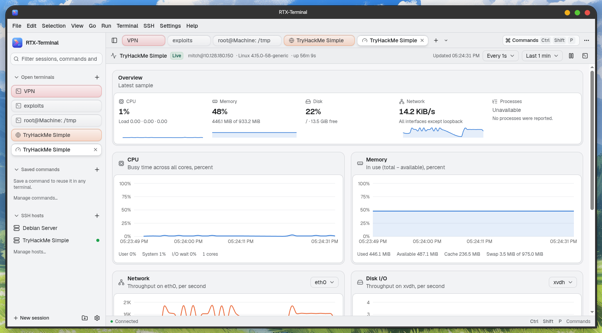
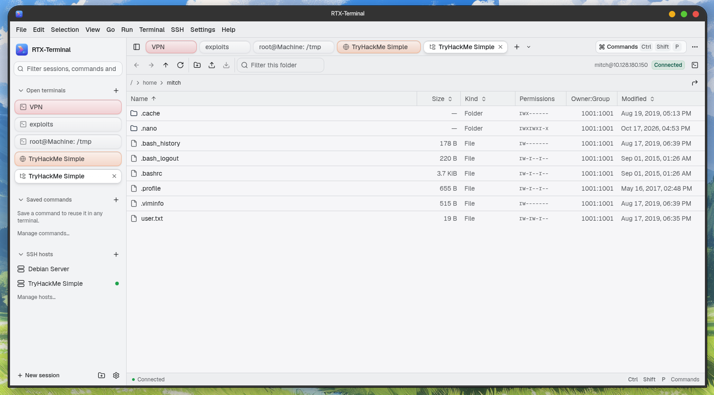

<p align="center">
  
</p>

<h1 align="center">
  
</h1>

<p align="center">
  Another yet modern terminal for Linux built with Electron, React, xterm.js and node-pty.
</p>

<p align="center">
  
</p>

## Features
<p align="center">
  SSH Resources Monitor
</p>
<p align="center">
  
</p>
<p align="center">
  SSH Remote File Manager
</p>
<p align="center">
  
</p>


- **Real local shells** through node-pty: interactive programs (`vim`, `top`, `htop`, `ssh`), ANSI and
  24-bit color, Unicode 11 widths, resize handling, clean process shutdown.
- **GPU rendering** with xterm.js' WebGL renderer, falling back to the DOM renderer when the GPU
  context is unavailable or lost. The status bar shows which renderer is active.
- **Tabs and split panes**: split right or down, resize with the dividers, move focus between panes.
  Switching tabs never restarts a shell.
- **Search** in terminal output (case, whole word and regex options).
- **Command palette** (`Ctrl+Shift+P`) for every action, theme switching, tab switching, saved commands
  and history.
- **Saved commands** with categories, tags, descriptions, optional shortcuts, import and export.
  _Insert_ types a command at the prompt; _Run_ also presses Enter. Commands that look destructive
  (`rm -rf`, `dd of=`, `mkfs`, `git reset --hard`, `sudo`, …) ask for confirmation before running.
- **Command history** recorded by the app, searchable, with privacy controls (off, this session, saved).
- **Saved sessions**: local shell profiles with a starting folder, organized in groups.
- **SSH sessions** through ssh2: saved hosts with groups, tags and search; password, private key
  (including encrypted keys) and ssh-agent authentication; host keys verified against the app's
  `known_hosts` and `~/.ssh/known_hosts`. SSH tabs sit next to local ones, work in split panes, show
  their connection state, and can be disconnected and reconnected explicitly (SSH menu, sidebar,
  pane menu, or `Ctrl+Shift+O` to connect).
- **Preferences**: font, size, line height, cursor, theme, default shell, initial size, scrollback,
  copy-on-select, GPU rendering, and configurable shortcuts.

## Requirements

- Linux x64, Node.js 22 or newer and npm (developed with Node 24 and npm 12).
- To build node-pty: `python3`, `make` and a C++ compiler (`sudo apt install build-essential python3`).
- To build the `.deb`: `dpkg` and `fakeroot` (`sudo apt install dpkg fakeroot`).

## Development

```bash
npm install
npm start            # Electron Forge dev mode with Vite hot reload
npm run typecheck    # tsc --noEmit (strict)
npm run lint         # oxlint and oxfmt --check
```

In development, `F12` toggles DevTools. Editing a file that holds live terminal state reloads the
window; the main process ends the old shells when the page navigates.

## Packaging

```bash
npm run package      # out/rtx-terminal-linux-x64/
npm run make:deb     # out/make/deb/x64/rtx-terminal_1.0.0_amd64.deb
sudo apt install ./out/make/deb/x64/rtx-terminal_1.0.0_amd64.deb
```

Packaging rebuilds node-pty against the installed Electron version, ships only its Linux binary
(unpacked from the asar archive) and its JavaScript, and bundles everything else with Vite. The
`.deb` declares Electron's runtime libraries (GTK 3, NSS, libdrm, libgbm, …) as dependencies.

## Architecture

```
src/
  main.ts                    Window, security policy, lifecycle and shutdown
  main/
    ipc.ts                   Every IPC handler, with sender and argument validation
    store.ts                 Versioned JSON files in ~/.config/rtx-terminal, atomic writes
    shells.ts                Shell discovery and resolution
    sessions/
      backend.ts             SessionBackend: the contract local and SSH sessions share
      local-pty.ts           node-pty implementation
      session-manager.ts     Session ownership, output batching, flow control, cleanup
    ssh/
      ssh-backend.ts         ssh2 client as a SessionBackend (shell, resize, keepalive, errors)
      ssh-sessions.ts        Opening a saved host: auth, host-key questions, saved secrets
      known-hosts.ts         OpenSSH known_hosts reading (hashed entries too) and app trust file
      secrets.ts             Passwords and passphrases encrypted with Electron safeStorage
      ssh-config.ts          Read-only subset of ~/.ssh/config
    ipc-validation.ts        Argument validators for every IPC request
  preload.ts                 Exposes the typed window.rtx API (contextBridge)
  shared/
    api.ts                   RtxApi interface and IPC channel names
    config.ts                Persisted data types, defaults and validators
  state/                     Renderer stores: app data, workspace (tabs, panes), UI
  features/
    terminal/                xterm controllers (outside React), pane tree, search, themes
    actions.ts               Every user action in one table
    shortcuts.ts             The single keyboard listener and shortcut resolution
    palette/ commands/ history/ settings/ sessions/ shell/ workspace/
  components/ui, components/reui   shadcn (base-nova) and ReUI components
```

- **Main process** owns PTYs, files and dialogs. Each session belongs to the window that created
  it; requests for other sessions are ignored. Output is coalesced (5 ms or 64 KB) and paused with
  xterm.js-style flow control when the renderer falls behind.
- **Renderer** keeps one `TerminalController` per pane outside React. Panes move between split
  containers without losing scrollback or restarting their process.
- **Sessions** use a `SessionBackend` interface implemented by node-pty (local) and ssh2 (SSH). The
  renderer only names a saved host id; the main process reads the host from disk, connects, and asks
  the renderer about unknown or changed host keys and missing passwords or passphrases.

## Security

- `contextIsolation`, `sandbox` and `webSecurity` on; `nodeIntegration` off; DevTools disabled in
  packaged builds.
- The renderer only sees `window.rtx` (terminal, system, store). No `ipcRenderer`, `require` or Node APIs.
- Every IPC handler checks that the sender is the app's own main frame and validates its arguments:
  UUID session ids, bounded sizes, absolute paths, http(s)-only URLs.
- Shells are started directly by node-pty with no arguments built from UI strings; typed input is
  written to the PTY as input.
- Packaged builds use a strict Content Security Policy (`script-src 'self'`); navigation, new windows,
  webviews and all permission requests are denied.
- Electron fuses disable `RunAsNode`, `NODE_OPTIONS` and inspector flags, and enforce asar integrity.
- **SSH host keys are always verified.** Unknown keys need explicit approval after showing the SHA256
  fingerprint. Changed keys block the connection; replacing one needs a separate confirmation.
  Revoked (`@revoked`) keys are refused. Only the app's own `known_hosts` is ever written.
- **SSH secrets** never go to disk in plaintext and never into logs. Typed passwords and passphrases go
  to one connection attempt; they are saved, encrypted with the system keyring through `safeStorage`,
  only when you ask and only after a successful sign-in. With no real keyring (`basic_text`), saving
  is refused. Private keys are read by the main process at connect time; only their path is saved.
- SSH never runs a local shell or external program, and `~/.ssh/config` is parsed as data: commands in
  it (`ProxyCommand`, `LocalCommand`, `Match exec`) are ignored.

## Data

Stored in `~/.config/rtx-terminal/`:

| File               | Contents                                              |
| ------------------ | ----------------------------------------------------- |
| `preferences.json` | Terminal, interface, shortcut and history settings    |
| `commands.json`    | Saved commands and categories                         |
| `sessions.json`    | Saved sessions, groups and SSH hosts (no secrets)     |
| `history.json`     | Command history, only when history is set to _Save_   |
| `known_hosts`      | SSH host keys you trusted in the app (OpenSSH format) |
| `ssh-secrets.json` | Saved SSH passwords/passphrases, keyring-encrypted    |

Files are versioned and validated on load. A file that is not valid JSON, or that was written by a
newer version, is renamed (for example `commands.json.corrupt-<time>`) and defaults are used; a
notification says so. Writes are atomic and use mode `0600`. Secrets exist only in
`ssh-secrets.json`, encrypted by the system keyring, and only for hosts where you chose to save one.
`~/.ssh/known_hosts` is read but never modified.

## Keyboard shortcuts

App shortcuts use `Ctrl+Shift` so plain `Ctrl` keys (`Ctrl+C`, `Ctrl+R`, `Ctrl+B`, …) reach the shell.
All of them can be changed in Settings → Keyboard.

| Action                             | Shortcut                      |
| ---------------------------------- | ----------------------------- |
| Command palette                    | `Ctrl+Shift+P`                |
| New tab                            | `Ctrl+Shift+T`                |
| Split right / down                 | `Ctrl+Shift+D` / `E`          |
| Close pane                         | `Ctrl+Shift+W`                |
| Next / previous pane               | `Ctrl+Shift+]` / `[`          |
| Next / previous tab                | `Ctrl+Tab` / `Ctrl+Shift+Tab` |
| Rename tab                         | `Ctrl+Shift+R`                |
| Find in terminal                   | `Ctrl+Shift+F`                |
| Copy / paste                       | `Ctrl+Shift+C` / `V`          |
| Select all output                  | `Ctrl+Shift+A`                |
| Clear terminal                     | `Ctrl+Shift+K`                |
| Run saved command                  | `Ctrl+Shift+S`                |
| Command history                    | `Ctrl+Shift+H`                |
| Connect to SSH host                | `Ctrl+Shift+O`                |
| Toggle sidebar                     | `Ctrl+Shift+B`                |
| Font size bigger / smaller / reset | `Ctrl+Shift+=` / `-` / `0`    |
| Settings                           | `Ctrl+,`                      |

Links in the terminal open with `Ctrl+click`. Programs that use the mouse (htop, vim) receive right
clicks; `Shift+right click` opens the terminal menu over them.

## Known limitations

- **No session restore.** Tabs and shells are not restored after the app exits; only preferences,
  saved commands, saved sessions and (optionally) history persist.
- **SSH**: no jump hosts (`ProxyJump`/`ProxyCommand`), port forwarding, X11, SFTP or agent forwarding.
  From `~/.ssh/config` only `HostName`, `User`, `Port` and `IdentityFile` are read. Disconnected
  sessions are never reconnected automatically, and a reconnect starts a new remote shell. SSH
  connectivity was verified against an ssh2-based test server, not against OpenSSH.
- **History is app-observed, not shell history.** Only lines typed with plain editing that the
  terminal echoed, and commands run from the app, are recorded. Lines edited with arrows or Tab
  completion, unechoed input (passwords), full-screen programs and lines starting with a space are
  skipped. Each line of a multi-line command is recorded separately.
- **Destructive-command detection is a safety net** for one-click runs from the app. Anything typed
  by hand goes straight to the shell.
- **One window.** A second launch focuses the existing window.
- Only the `.deb` was built and tested. The RPM maker is configured but needs `rpmbuild`.

## Rust evaluation

Rust was considered for performance-sensitive parts and is **not used**. The hot paths are already
native or GPU-backed: node-pty is a C++ addon, xterm.js parses in an optimized TypeScript state
machine, rendering runs on WebGL, and output is batched with flow control. A Rust module (via
napi-rs) would add a second toolchain and per-architecture builds without a measured bottleneck to
remove. It becomes worthwhile for a well-defined task with measurable cost, for example an SSH
transport behind `SessionBackend`, large-scale log indexing or session-recording compression.
