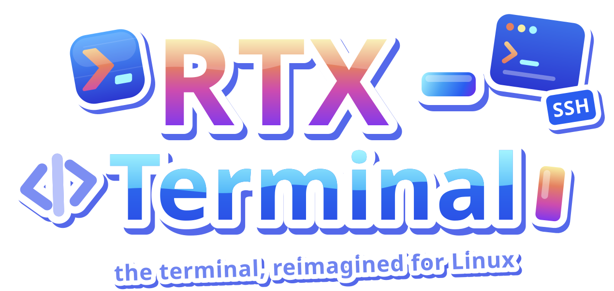
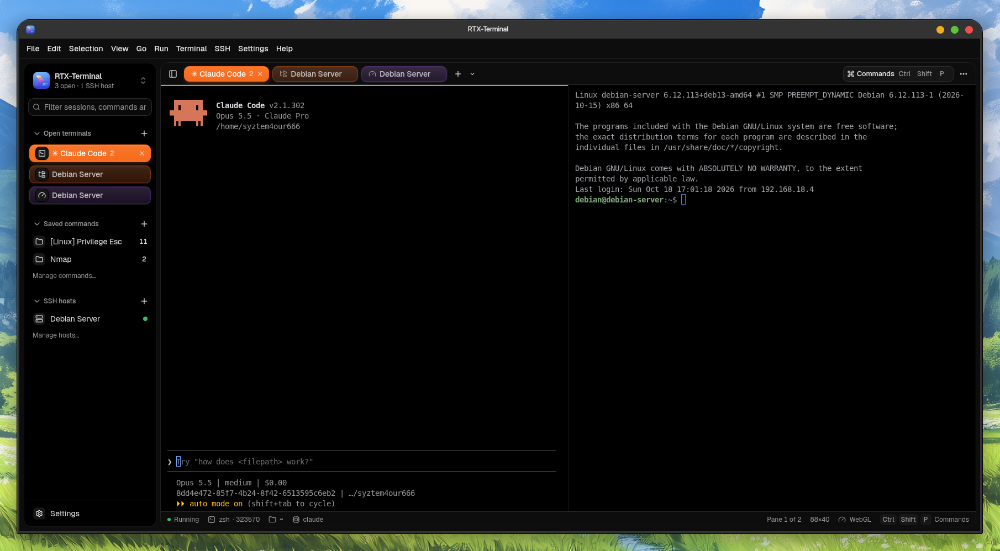
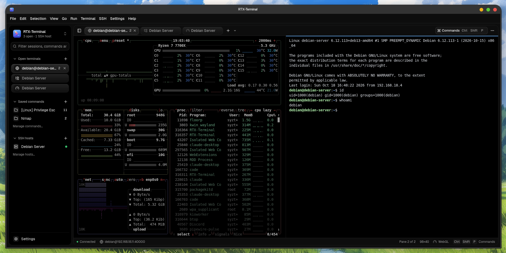
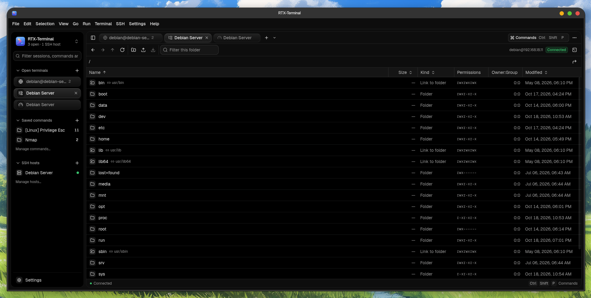
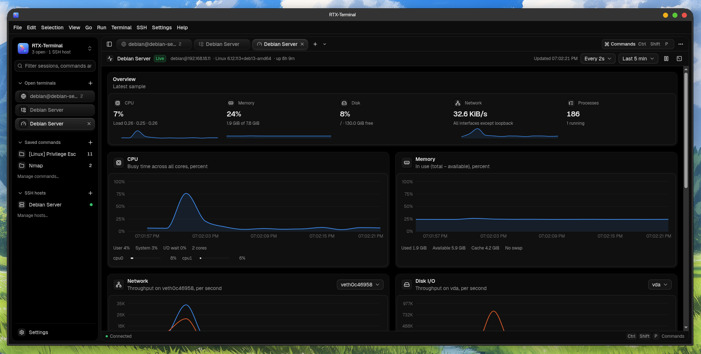

<p align="center">
  
</p>

<h1 align="center">
  
</h1>

<p align="center">
  A modern, keyboard-driven terminal for Linux with tabs, split panes, saved commands,<br>
  SSH sessions, a remote file manager and a live resource monitor.
</p>

<p align="center">
  <a href="https://github.com/0x0f2Root/rtx-terminal/releases/latest"></a>
  <a href="LICENSE"></a>
  
  
</p>

<p align="center">
  <a href="#install">Install</a> ·
  <a href="#features">Features</a> ·
  <a href="#keyboard-shortcuts">Shortcuts</a> ·
  <a href="#build-from-source">Build from source</a> ·
  <a href="#architecture">Architecture</a>
</p>

<p align="center">
  
</p>

## Install

Download the latest `.deb` from the [Releases page](https://github.com/0x0f2Root/rtx-terminal/releases/latest)
and install it with apt, which also pulls in the libraries Electron needs:

```bash
sudo apt install ./rtx-terminal_0.0.1_amd64.deb
```

Then start **RTX-Terminal** from your application menu, or run `RTX-Terminal` in a shell.

To remove it:

```bash
sudo apt remove rtx-terminal
```

Your settings, saved commands and hosts stay in `~/.config/rtx-terminal`; delete that folder for a
clean uninstall. Passwords and passphrases live in your system keyring, never in those files.

> RTX-Terminal currently targets Debian, Ubuntu and their derivatives on x64. Other distributions can
> [build from source](#build-from-source).

## Features

### Terminal

- **Tabs and split panes.** Split right or down, resize with the dividers and move focus between
  panes. Switching tabs never restarts a shell, and tabs can be renamed and colored.
- **GPU rendering** through WebGL, with an automatic fallback when the GPU is unavailable.
- **Search** terminal output with case, whole word and regex options.
- **Command palette** (`Ctrl+Shift+P`) for every action, theme, tab, saved command and history entry.
- **Command history** you can search and re-insert at the prompt.

### Saved commands

- Organize commands in **categories** with tags, descriptions and optional shortcuts.
- **Insert** types a command at the prompt; **Run** also presses Enter.
- Commands that look destructive (`rm -rf`, `dd of=`, `mkfs`, `git reset --hard`, `sudo`, …) ask for
  confirmation before they run.
- **Import and export** your library as JSON.

### SSH

- **Saved hosts** with groups, tags and search, plus `~/.ssh/config` aliases.
- Password, private key (including encrypted keys) and **ssh-agent** authentication. Secrets are kept
  in the system keyring, never in config files.
- **Host keys** are verified against the app's own store and `~/.ssh/known_hosts`; unknown or changed
  keys always ask first.
- SSH tabs sit next to local ones, work in split panes and can be disconnected and reconnected.

<p align="center">
  
</p>

### Remote file manager

- Browse, rename, create and delete files and folders over SFTP.
- Upload and download with a transfer queue. You are only asked what to do when a file with the same
  name already exists, and the safe choice keeps both copies.

<p align="center">
  
</p>

### Resource monitor

- Live CPU, memory, disk, network and load charts for any SSH host, with no agent to install.
- A sortable, filterable process table.

<p align="center">
  
</p>

### Look and feel

- Four app themes: **Gray Dark**, **Full Black**, **Light** and **Glass** (translucent panels over a
  wallpaper of your choice, with adjustable blur, tint and dimming).
- Independent terminal color schemes, fonts, line height, cursor style and scrollback.
- Every shortcut can be changed in **Settings → Keyboard**.

## Keyboard shortcuts

App shortcuts use `Ctrl+Shift`, so plain `Ctrl` keys (`Ctrl+C`, `Ctrl+R`, `Ctrl+B`, …) reach the shell.

| Action                             | Shortcut                      |
| ---------------------------------- | ----------------------------- |
| Command palette                    | `Ctrl+Shift+P`                |
| New tab                            | `Ctrl+Shift+T`                |
| Split right / down                 | `Ctrl+Shift+D` / `E`          |
| Close pane                         | `Ctrl+Shift+W`                |
| Next / previous pane               | `Ctrl+Shift+]` / `[`          |
| Next / previous tab                | `Ctrl+Tab` / `Ctrl+Shift+Tab` |
| Rename tab                         | `Ctrl+Shift+R`                |
| Find in terminal                   | `Ctrl+Shift+F`                |
| Copy / paste                       | `Ctrl+Shift+C` / `V`          |
| Select all output                  | `Ctrl+Shift+A`                |
| Clear terminal                     | `Ctrl+Shift+K`                |
| Run saved command                  | `Ctrl+Shift+S`                |
| Command history                    | `Ctrl+Shift+H`                |
| Connect to SSH host                | `Ctrl+Shift+O`                |
| Toggle sidebar                     | `Ctrl+Shift+B`                |
| Font size bigger / smaller / reset | `Ctrl+Shift+=` / `-` / `0`    |
| Settings                           | `Ctrl+,`                      |

## Build from source

### Requirements

- Linux x64 with **Node.js 22 or newer** and npm (developed with Node 24).
- A toolchain for the native `node-pty` module: `sudo apt install build-essential python3`
- For the `.deb`: `sudo apt install dpkg fakeroot`

### Run in development

```bash
git clone https://github.com/0x0f2Root/rtx-terminal.git
cd rtx-terminal
npm install
npm start            # Electron Forge with Vite hot reload
```

`F12` toggles DevTools. Changes to the main process need a full restart of `npm start`.

### Check

```bash
npm run typecheck    # tsc --noEmit (strict)
npm run lint         # oxlint and oxfmt --check
npm test             # vitest
```

### Package

```bash
npm run package      # unpacked app in out/RTX-Terminal-linux-x64/
npm run make:deb     # out/make/deb/x64/rtx-terminal_<version>_amd64.deb
```

Packaging rebuilds `node-pty` against the bundled Electron, ships only its Linux binary and
JavaScript, and bundles everything else with Vite. The `.deb` declares Electron's runtime libraries
(GTK 3, NSS, libdrm, libgbm, …) as dependencies.

## Architecture

| Layer            | Responsibility                                                                                                                                                                                                       |
| ---------------- | -------------------------------------------------------------------------------------------------------------------------------------------------------------------------------------------------------------------- |
| **Main process** | Owns PTYs, SSH connections, SFTP, files and native dialogs. Every IPC message is validated, and each session belongs to the window that created it. Output is coalesced (5 ms or 64 KB) with xterm.js flow control. |
| **Preload**      | Exposes a small, typed `window.rtx` API through `contextBridge`; the page has no Node.js access.                                                                                                                   |
| **Renderer**     | React 19 UI built on shadcn/ui and ReUI. One `TerminalController` per pane lives outside React, so panes move between splits without losing scrollback or restarting their process.                               |
| **Sessions**     | A `SessionBackend` interface implemented by node-pty (local) and ssh2 (SSH). The renderer only names a saved host id; the main process reads the host from disk and asks the renderer about host keys and secrets.   |

**Tech stack:** Electron, React, TypeScript, Vite, xterm.js, node-pty, ssh2, Tailwind CSS, shadcn/ui,
ReUI, Electron Forge.

## Contributing

Issues and pull requests are welcome. Before opening a pull request, make sure `npm run typecheck`,
`npm run lint` and `npm test` pass.

## License

[MIT](LICENSE) © 0x0f2Root
